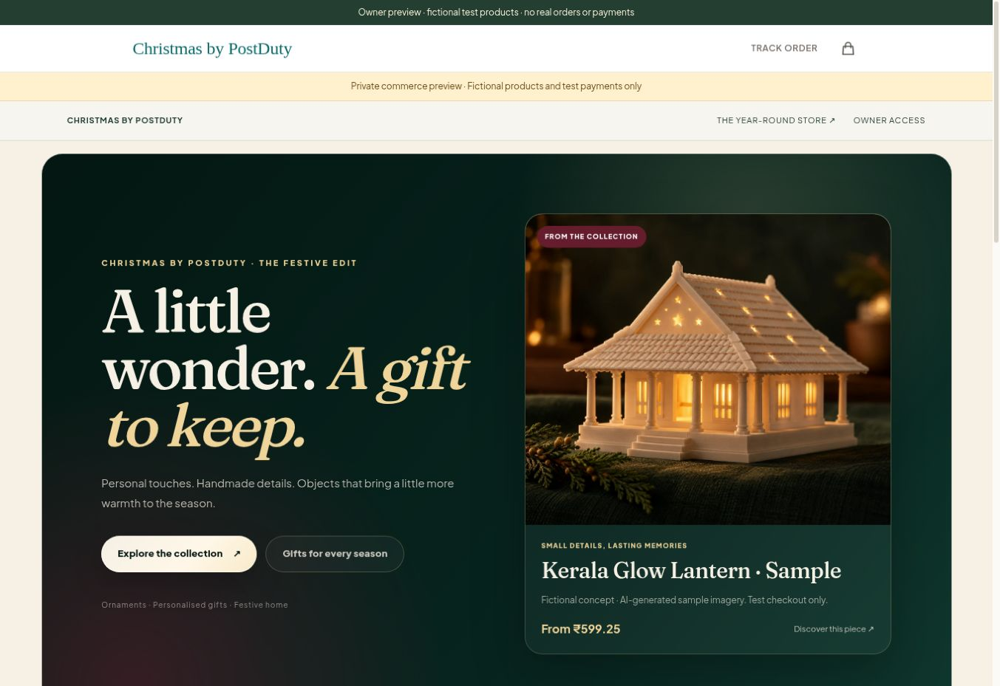
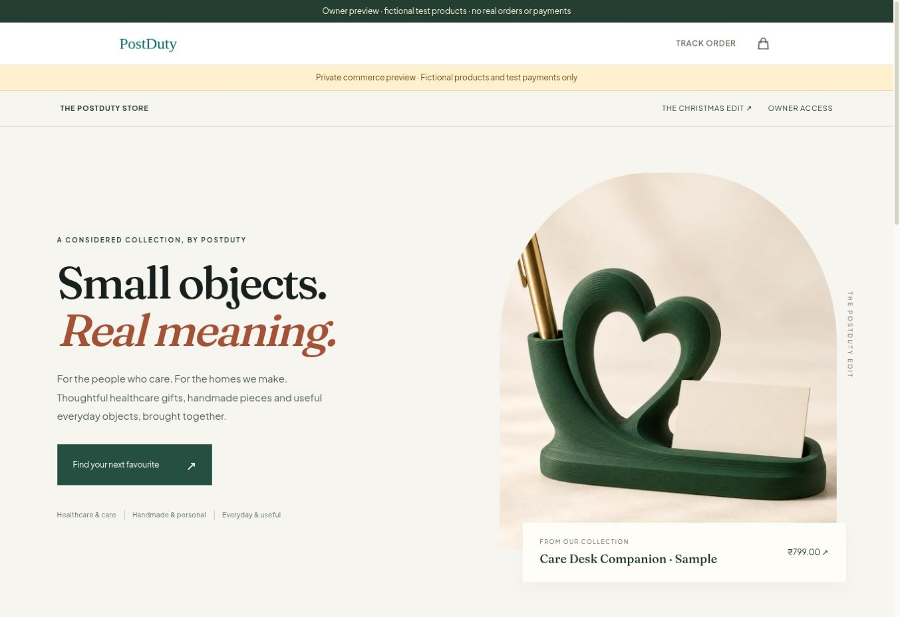
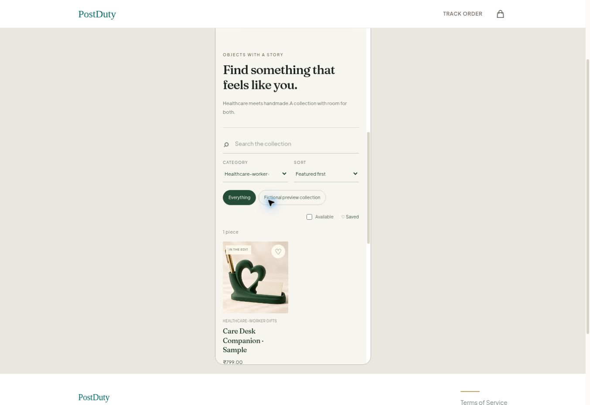
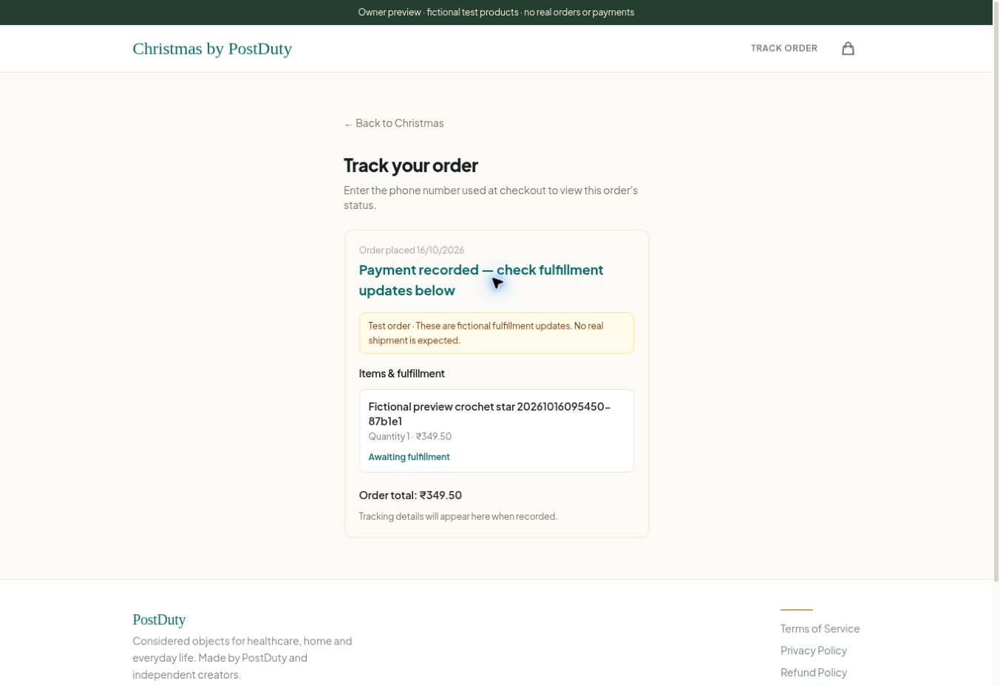

# Deployed commerce verification — 16 October 2026

**Superseded preview addresses:** the later owner-approved protected deployment and reversible design comparison are documented in [refinement-and-access-2026-10-16.md](refinement-and-access-2026-10-16.md). The version URLs below now return 404. The initial vulnerable preview's retirement is now verified. This report remains the historical checkout evidence for the earlier runtime.

## Working preview

- [Christmas collection](https://commerce-preview-postduty.jijo925.workers.dev/christmas)
- [General marketplace](https://commerce-preview-postduty.jijo925.workers.dev/store)
- [Owner sign-in](https://commerce-preview-postduty.jijo925.workers.dev/admin/login)

Verified in the browser after the final upload. Runtime source: `c55e08cd517e954aa58da24ab2b53eb94112dec9`. Cloudflare version: `2cb6d725-6ff8-4117-8d76-8907ba73959a`. The version-specific verification target is `https://2cb6d725-postduty.jijo925.workers.dev`. The stable alias points to this version. No production traffic or domain mapping was changed.

## Evidence

| Check | Result and limits |
| --- | --- |
| Local boundary suite | 93 tests passed, zero failures or skips, plus business-metric boundary script. TypeScript and lint pass; 10 lint warnings remain. |
| GitHub CI | Run 38886477989 / PostDuty CI #22 passed on the runtime commit. |
| Initial deployed API smoke | 18 checks passed: protected login, CSRF, image/video upload, active-file rejection, draft creation, publication, assignment, unpublish/republish, duplicate/archive, authoritative prices and forged-payment rejection. See deployed-smoke.json; its original preview has been superseded. |
| Actual browser checkout | Razorpay TEST bank success created one captured INR 349.50 order. Saved phone-gated order lookup renders the item, recorded payment, test notice and awaiting-fulfillment status. No actual shipment is claimed. |
| Final deployed recheck | All 8 grouped checks passed on the final version. Two genuine callback replays retained the same order, item and capture; crochet stock remained 7. See final-deployed-verification.json. |
| Manual refund service case | Requested → approved → resolved; stale version rejected with 409 and excessive amount with 400. Provider refunded amount remained zero; no order, stock or notification changes. This proves a manual ledger only. |
| Data preservation | Original products 2, original orders 13 before and after. Preview has 1 order / 1 item / 1 captured payment; all preview tables have RLS. All notification jobs for the test order remain suppressed. |
| Analytics | Exactly 1 verified test order / 34950 paise for 16 October in IST; test data is not real revenue. Three dated, sourced research records persisted. No demand, conversion or realized profit conclusion is supported. |
| Mobile browser | Real pages rendered in 360px and 390px iframe viewports. Christmas measured 348/348 and 378/378 client/scroll widths respectively; general store measured 348/348 at 360px. Search filtered Christmas to crochet; category filter returned the healthcare product in the general store. These are browser-width tests, not physical Android acceptance. |
| Independent review | Final confirmation/security diff reviewed at d2403627; tracking diff independently reviewed and its 7 tests rerun. Prior per-item tracking gap resolved. |
| Creator workflow | 14 local API/PostgreSQL tests include a full fictional two-creator workflow and access isolation. Google identity transport was mocked; real creator OAuth and phone UI are not accepted yet. |

## Security and release gates

Runtime dependencies were patched to Next.js 16.4.2 / OpenNext 1.20.12. Runtime npm audit reports zero advisories; five development-only entries share one upstream unpatched braces advisory. Production remains on its existing dependency baseline until an approved release.

The initial unpatched version `2cd9f9c0-ec20-410f-979e-476730d6316d` was deleted through Cloudflare's documented version API after confirming it was absent from production deployment history and a patched replacement was accessible. The API subsequently returned 404 for that version and production deployment history was unchanged. **Its older version URL still returned the earlier fictional catalog at the last edge check. Public retirement is therefore not verified.** Do not distribute that URL or treat the successful API deletion as access revocation. A controlled preview-access restriction or provider follow-up is still required; changing all existing PostDuty version-URL access is an owner security configuration gate. The delivered stable alias and final version URL serve the patched build.

Preview storefronts are publicly reachable test catalogs; owner and creator operations require server-side authentication. The preview has separate tables and media but shares the existing Supabase project and service principal. This is not a separate-account security boundary.

Google commerce sign-in is unconfigured. The already authorized Google owner was identified in Command Centre, but its user UUID belongs to another Auth issuer and must not be blindly reused. Approve the controlled provider/callback setup and exact immutable owner binding, plus preview access restrictions, before declaring identity/security acceptance. Real creator invitations, live payments, notifications, production migrations and release remain gated.

Command Centre writes returned an invalid/expired request-state error. Status is recorded in GitHub issue #16 and draft PR #17; no successful Command Centre update is claimed.

## Screenshots

See preview-handoff.md for the owner walkthrough, remaining feature limits and proposed production sequence. This verification does not authorize production release or establish commercial/legal readiness.
